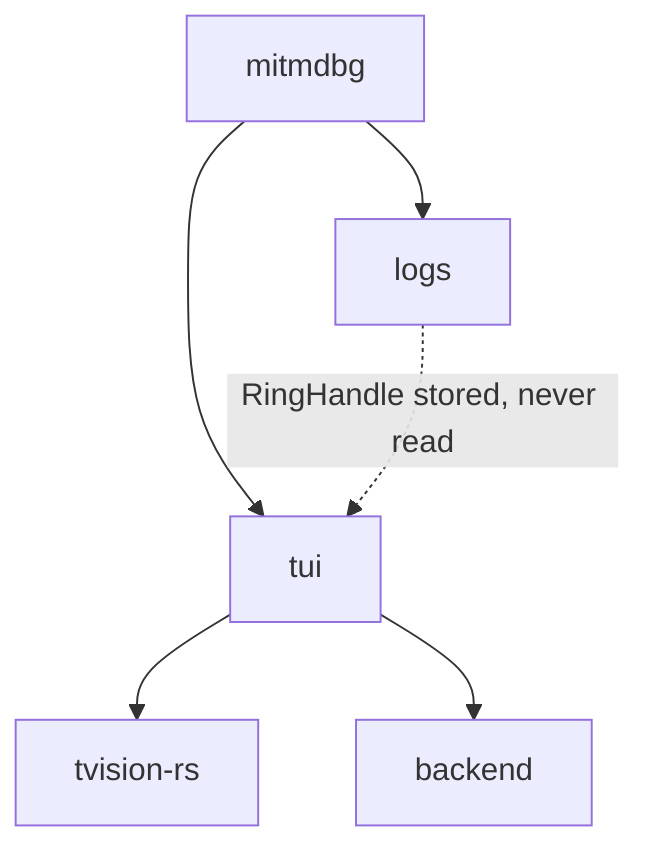
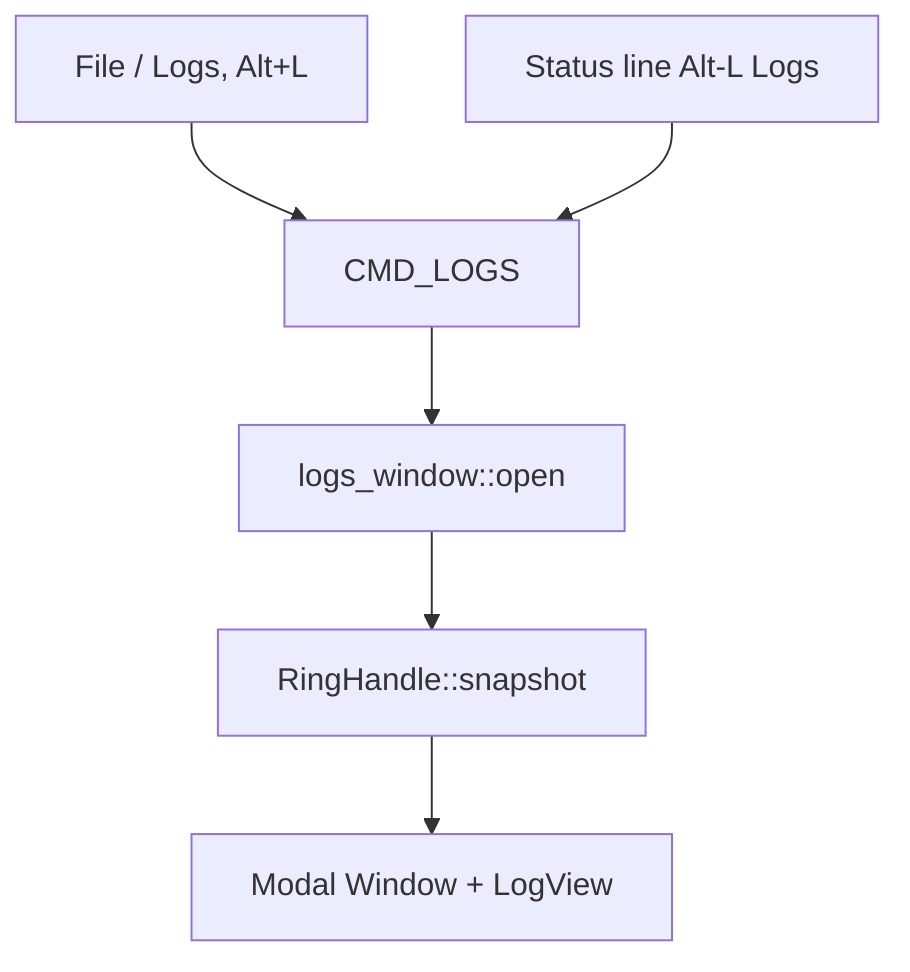

# Architecture Proposal: Logs Window
<!-- Link base: write relative links with the repository root as the base. -->

> **Note:** This proposal follows the workflow defined in [ARCHITECT.md](agentic/ARCHITECT.md).

- **Author:** Cascade agent session
- **Created:** 2026-10-25
- **Status:** created
- **Implemented:** —

## 1. Summary

Add a modal Logs window to `crates/tui`. The window opens from `File → Logs` and via `Alt+L`. It shows the records in the `logs` crate ring buffer as scrollable read-only text, scrolled to the end on open. It has no buttons. Esc or a click on the window close marker closes it.

## 2. Motivation

`mitmdbg` installs `logs::init` at startup and passes the returned `RingHandle` into `tui::run` (`mitmdbg/src/main.rs`). `App` stores the handle (`crates/tui/src/app.rs`) but nothing reads it. Operators cannot see what the application logged without leaving the TUI and opening `workspace/log.txt`. A modal log viewer gives immediate in-app observability at minimal cost, because the data path already exists.

## 3. Current Architecture

`crates/logs` captures every `tracing` record into a bounded `RingBuffer` behind `Arc<Mutex>` and exposes `RingHandle::snapshot() -> Vec<LogRecord>` (`crates/logs/src/ring.rs`). `LogRecord` carries `ts`, `level`, `target`, and `message`.

`crates/tui` builds on the vendored `tvision-rs` crate (`external/tvision-rs`, dependency name `tv`). `App::run` drives `Program::run_app` with a command callback (`crates/tui/src/app.rs`). `desktop.rs` builds the menu bar, status line, and desktop. `commands.rs` defines app commands such as `CMD_ABOUT` via `Command::custom`.

`tvision-rs` provides the required pieces:

- `Window` with a close flag enabled by default (`external/tvision-rs/src/window/window.rs`). A close-marker click posts `Command::CLOSE`; in a modal `exec_view` the program maps it to `Command::CANCEL`.
- `Program::exec_view` runs a view as a blocking modal. Esc posts `Command::CANCEL` and ends the modal (`external/tvision-rs/src/app/program.rs`).
- `Scroller` is the scrollable interior primitive with `set_limit`, `scroll_to`, and scrollbar wiring (`external/tvision-rs/src/widgets/scroller.rs`).

## 4. Proposed Changes

### Structural changes

- Add `crates/tui/src/logs_window.rs`. It owns two items:
  - `format_records(&[LogRecord]) -> String` renders one `ts [level] target: message` line per record, oldest first.
  - `open(program: &mut Program, logs: &RingHandle)` snapshots the ring, builds a `Window` at ~80% of the screen centered, inserts the log view, and calls `exec_view`.
- Add a `LogView` type in `logs_window.rs`: a `View` implementation that draws the formatted text through the `Scroller` machinery. Alternative: reuse an existing scrolled widget when one fits; `LogView` stays the fallback.
- Extend `commands.rs` with `CMD_LOGS: Command = Command::custom("logs")`.
- Extend `desktop.rs`:
  - `File` submenu gains `~L~ogs`, bound to `CMD_LOGS` with the `Alt+L` key event and `Alt-L` hint text.
  - Status line gains an `~Alt-L~ Logs` item bound to `CMD_LOGS`.
- Extend `app.rs`: the `run_app` callback dispatches `CMD_LOGS` to `logs_window::open(program, &self.logs)`.

### Data and type changes

- No changes to `logs`. `RingHandle::snapshot()` already returns an owned `Vec<LogRecord>`.
- No serialization boundary changes.

### Concurrency and state changes

- The modal snapshots the ring buffer once at open. Records that arrive while the modal runs do not appear. This keeps the view consistent and removes any lock interaction during modal execution.
- No new threads, channels, or shared state.

### Integration changes

- `Alt+L` works through two paths: the menu item key binding and the status-line item. Both emit `CMD_LOGS`. No global key interception in `App` is needed.
- All user-visible strings (`Logs`, menu entry, status item) go through `i18n::i18n!`.

## 5. Trade-offs

### Benefits

- **In-app observability:** operators inspect recent logs without leaving the TUI.
- **No `logs` changes:** the existing `RingHandle` API covers the feature.
- **Native modal semantics:** `exec_view` gives Esc-to-close and close-marker behavior for free.

### Costs and Risks

- **Stale content while open:** new records do not appear until reopen. Mitigation: documented behavior; a live-refresh variant can come later if needed.
- **`Scroller` integration detail:** `LogView` must wire scrollbar updates and `scroll_to` correctly. Mitigation: keep `LogView` small and covered by snapshot tests through the `tvision-rs` headless backend.

### Alternatives Considered

- **Live-updating view:** rejected. It needs periodic snapshot refresh inside the modal and adds complexity for no stated requirement.
- **`StaticText` instead of a scrolled view:** rejected. `StaticText` does not scroll; the ring can hold 1000 records.
- **Non-modal desktop window:** rejected. The requirement is a modal dialog.

## 6. Implementation Plan

Implementation follows the Planning and Execution Workflow in [agentic/WORKFLOW.md](agentic/WORKFLOW.md). The change stays inside `crates/tui` and touches no public API of other crates, so a Standard plan tier in `project/PLAN_logs_window.md` suffices. Do not touch files outside this scope.

- **Phase A — command and entry points**
  - **Goal:** `CMD_LOGS` exists and both the `File → Logs` item (`Alt+L`) and the status-line item emit it.
  - **Files to touch:** `crates/tui/src/commands.rs`, `crates/tui/src/desktop.rs`.
  - **Approach:** add the constant; add `m.command_key("~L~ogs", CMD_LOGS, alt_char_event('l'), "Alt-L")` to the `File` submenu; add the status-line `StatusDef` item.
- **Phase B — log view and modal**
  - **Goal:** `logs_window.rs` renders the snapshot and opens the modal scrolled to the end.
  - **Files to touch:** `crates/tui/src/logs_window.rs` (new), `crates/tui/src/lib.rs` (module declaration).
  - **Approach:** `format_records` joins records with `\n`. `LogView` draws visible lines via `Scroller` state with a vertical scrollbar. On open, set the scroll position to the bottom. Wrap in `Window::new(bounds, Some("Logs"), 0)` and run `program.exec_view`.
- **Phase C — dispatch and verification**
  - **Goal:** `CMD_LOGS` opens the modal; build and tests pass.
  - **Files to touch:** `crates/tui/src/app.rs`.
  - **Approach:** match `CMD_LOGS` in the `run_app` callback; call `logs_window::open(program, &self.logs)`. Run `cargo build --workspace` and `cargo clippy`.

## 7. Testing Strategy

- **Unit tests:** `format_records` ordering (oldest first) and empty input; reuse the style of `crates/logs` tests.
- **Integration tests:** drive `mitmdbg`-equivalent `Program` setup through the `tvision-rs` `HeadlessBackend`: assert `Alt+L` opens the modal, the last record is visible, Esc closes it, and `Command::CLOSE` (close marker) closes it. Snapshot tests follow the crate's `snapshots/` convention.
- **Invariant checks:** only `crates/tui` depends on `tv`; `logs` unchanged; Esc and close marker are the only close paths (no buttons); `cargo build --workspace` and `cargo clippy` clean.
- **Migration or rollback tests:** none; the change adds a module and menu entries only.

These checks become Acceptance Criteria in `project/PLAN_logs_window.md`.

## 8. Open Questions

- **Scroll widget choice:** whether an existing `tvision-rs` widget (e.g. a read-only `Editor`) fits better than a custom `LogView` on `Scroller`. Decided during implementation; the proposal stays valid either way. `non-blocking`.
- **Stale `tvui/` directory:** the abandoned turbo-vision experiment sits at the repo root outside the workspace. Left untouched; may be deleted later. `non-blocking`.
